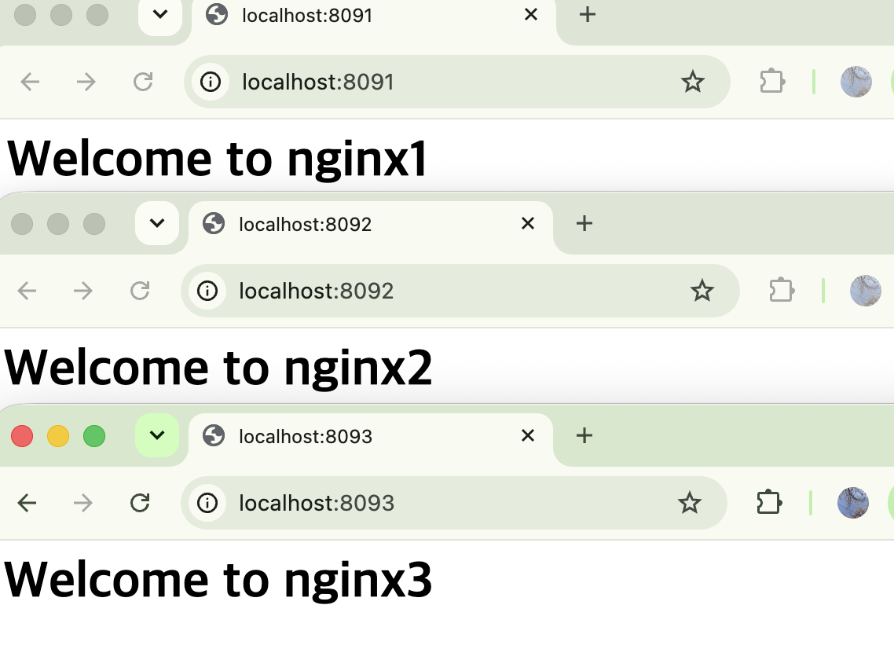

# 5주차 Docker

> Docker 설치하고 nginx 컨테이너 띄워보기 + Issue 기반으로 작업 관리

## 이슈 완료 조건
- [x] docker --version 정상 출력
- [x] docker run hello-world 실행
- [x] web 이라는 이름으로 nginx 컨테이너 실행
- [x] curl로 http://localhost:8080 응답 확인
- [x] docker ps에서 실행 상태를 확인
- [x] 실습 결과를 week05/README.md에 기록
- [x] 수업에서 만든 컨테이너 정리
- [x] 혼자서 해보기 완료

## 결과
```
$ docker --version
Docker version 29.7.2, build a7dcaa6

$ docker run --rm hello-world
Hello from Docker!
...
 2. The Docker daemon pulled the "hello-world" image from the Docker Hub.
    (arm64v8)
```
(arm64v8) → 맥이 애플실리콘이라 arm64 이미지를 받은거

```
$ docker run -d -p 8080:80 --name web nginx
$ curl -I http://localhost:8080
HTTP/1.1 200 OK
Server: nginx/1.31.6

$ docker ps
CONTAINER ID   IMAGE   ...   PORTS                                     NAMES
b8fa837b10db   nginx   ...   0.0.0.0:8080->80/tcp, [::]:8080->80/tcp   web
```

nginx 설치 안했는데 run 한번에 웹서버 뜸. 이미지 안에 다 들어있어서

## 배운 거
- 이미지 = 붕어빵 틀 (읽기전용), 컨테이너 = 붕어빵
- `-d` 백그라운드 / `-p 8080:80` 내 8080 → 컨테이너 80 / `--name` 이름 / `-e` 환경변수
- 컨테이너 3개 다 안에서 80 써도 충돌 X. 호스트 포트만 다르면 됨
- 이름 같은거로 또 run 하면 Conflict

```bash
docker ps -a           # 멈춘거까지
docker logs -f web
docker exec -it web bash
docker stop / start / restart
docker rm -f web       # 컨테이너만 지워짐. 이미지는 남음
docker images
```

컨테이너 안에서 index.html 고쳐도 rm 하고 다시 run 하면 원래 nginx 화면으로 돌아옴
→ 쓰기 계층이 컨테이너랑 같이 삭제돼서

맥 docker desktop은 리눅스 VM 띄워서 그 커널을 씀 (맥 커널 공유 X)

## 혼자서 해보기 - nginx 3개
```bash
docker run -d -p 8091:80 --name nginx1 nginx
docker run -d -p 8092:80 --name nginx2 nginx
docker run -d -p 8093:80 --name nginx3 nginx

# 각 컨테이너 들어가서 index.html 바꾸기
docker exec -it nginx1 bash
echo "<h1>Welcome to nginx1</h1>" > /usr/share/nginx/html/index.html
exit
# nginx2, nginx3도 똑같이

curl localhost:8091
curl localhost:8092
curl localhost:8093
```
```
$ curl localhost:8091
<h1>Welcome to nginx1</h1>
$ curl localhost:8092
<h1>Welcome to nginx2</h1>
$ curl localhost:8093
<h1>Welcome to nginx3</h1>
```
브라우저로 8091, 8092, 8093 각각 열어서 확인한 결과


같은 이미지인데 컨테이너마다 내용이 따로 바뀜. 안에서는 셋 다 80인데 바깥 포트만 다르면 됨

```bash
docker rm -f web nginx1 nginx2 nginx3   # 정리
```

## Issue 흐름
Issue → 브랜치 → 작업 → commit/push → PR (본문에 Closes #번호) → merge → 이슈 자동으로 닫힘

## 정리
내 컴퓨터에서 되는 프로그램이 다른 컴퓨터에서 안 되는 건 OS, 언어 버전, 라이브러리가 다르기 때문이다. Docker는 앱과 실행에 필요한 환경을 이미지로 묶어서 어디서든 비슷하게 실행되게 해준다.

이미지는 읽기 전용 틀이고, 이걸 실행한 게 컨테이너다. 하나의 이미지로 컨테이너를 여러 개 만들 수 있고, 각자 격리돼 있어서 안에서는 다 80번 포트를 써도 바깥(호스트) 포트만 다르면 충돌하지 않는다. -p로 포트를 연결하고 -d로 백그라운드 실행, exec로 안에 들어가서 확인할 수 있다.

컨테이너 안에서 바꾼 파일은 쓰기 계층에만 있어서 컨테이너를 삭제하면 같이 사라진다. 원본 이미지는 그대로다.

작업은 Issue로 목표와 완료 조건을 먼저 적고, 브랜치에서 진행한 다음 PR 본문에 Closes #번호를 넣어 merge하면 이슈까지 자동으로 닫힌다.

## 주의!
- Docker Desktop 안 켜면 docker 명령 다 안 됨
- 같은 --name 으로 다시 run 하면 Conflict → rm -f 먼저
