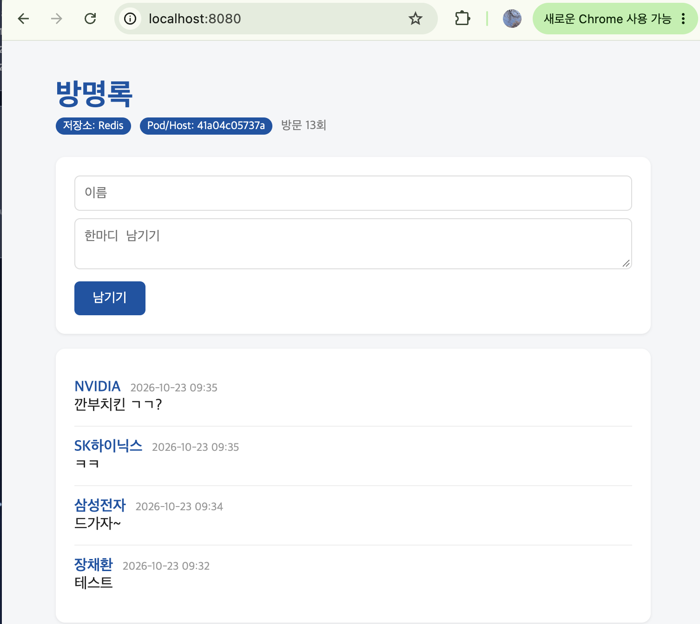

# 7주차 Docker Compose

> 방명록에 Redis 붙여서 compose로 여러 컨테이너 같이 띄우기 (nginx + web 3개 + redis)

방명록이 재시작하면 글 날아감 (저장소: Memory) → DB(Redis) 붙이기
앱이랑 DB를 컨테이너 하나에 넣으면 앱만 바꿔도 DB까지 재시작됨 → 컨테이너 하나에 역할 하나

```
브라우저:8080 → nginx → web x3 → redis → 볼륨(redis-data)
```

파일은 guestbook 폴더에 있음 (compose.yaml, nginx.conf, .env.example)

## compose.yaml
- `REDIS_HOST: "redis"` IP 말고 서비스 이름 씀. 컴포즈가 만든 네트워크에서 도커 DNS가 알아서 IP로 바꿔줌
- redis는 ports를 안 열어서 내 맥에서 localhost:6379로 접속 안됨. 같은 네트워크에 있는 web만 접근 가능
- `volumes: redis-data:/data` 데이터는 컨테이너 밖 볼륨에
- `depends_on` 만 쓰면 redis가 '시작'만 하면 web 켜짐. 준비 안됐을수도 있음
  → `condition: service_healthy` + healthcheck 로 redis healthy 된 다음에 web 시작
- `restart: unless-stopped` 갑자기 죽으면 다시 켜줌

## 실행
```bash
cd ~/devops/guestbook
docker compose config --quiet && echo OK
docker compose up -d --scale web=3
docker compose ps
```
```
NAME                IMAGE            SERVICE   STATUS                    PORTS
guestbook-nginx-1   nginx:alpine     nginx     Up 8 minutes              0.0.0.0:8080->80/tcp
guestbook-redis-1   redis:7-alpine   redis     Up 8 minutes (healthy)    6379/tcp
guestbook-web-1     guestbook-web    web       Up 8 minutes (healthy)    5000/tcp
guestbook-web-2     guestbook-web    web       Up 35 seconds (healthy)   5000/tcp
guestbook-web-3     guestbook-web    web       Up 8 minutes (healthy)    5000/tcp
```
redis랑 web 3개 다 healthy. redis는 6379/tcp만 있고 0.0.0.0 연결이 없음 = 밖에 안 열림
새로고침할때마다 Pod/Host 값이 바뀜 = nginx가 web 3개한테 돌아가면서 보냄
글은 어디로 가든 똑같음 (redis 하나에 있으니까)



## down / down -v
- down 하고 up → 글 남아있음 (볼륨은 안 지워짐)
- down -v 하고 up → 글 사라짐 (볼륨까지 삭제)
- 실제 서비스에서 -v 잘못치면 큰일

## scale 하다 막힌거
ports "8080:5000" 그대로 두고 --scale web=3 하면 port is already allocated
3개가 다 8080 쓰려고 해서 → web은 expose: "5000"으로 바꾸고 nginx만 8080 열어서 나눠주게 함

nginx.conf에서 `proxy_pass http://web:5000` 바로 안쓰고 resolver 127.0.0.11 + 변수로 쓴 이유 : 컨테이너 IP 바뀌어도 5초마다 다시 물어보게

## .env
compose.yaml에 비밀번호 devops1234 그대로 써서 깃헙에 올리면 전세계 공개
나중에 지워도 커밋 기록에 남음
→ .env에 넣고 .gitignore. compose.yaml엔 `${REDIS_PASSWORD}`만
.env.example은 뭘 넣어야 되는지 알려주는 양식

## web 하나 멈추면?
```bash
docker stop guestbook-web-2
```
나머지 2개가 응답해서 서비스는 됨. 근데 web-2는 아무도 안살림
unless-stopped는 내가 직접 멈춘건 다시 안켬
→ 개수 계속 보고 모자라면 다시 띄우는 스크립트 만듦 (guestbook/keep_web3.sh)

```
$ ./keep_web3.sh &
$ docker stop guestbook-web-2
[+] up 4/4
 ✔ Container guestbook-redis-1 Healthy
 ✔ Container guestbook-web-1   Running
 ✔ Container guestbook-web-3   Running
 ✔ Container guestbook-web-2   Started      ← 스크립트가 다시 켬
$ sleep 7; docker compose ps
guestbook-web-2   ...   Up 35 seconds (healthy)
```
멈추자마자 스크립트가 알아서 web-2 다시 띄워서 3개 유지됨

## 남은 고민
컴포즈는 컴퓨터 1대 안에서만. 서버 여러대거나 서버가 죽으면 → 쿠버네티스

## 정리
메모리에만 저장하는 앱은 재시작하면 데이터가 사라지기 때문에 DB가 필요하다. 앱과 DB를 한 컨테이너에 넣으면 앱만 바꿔도 DB까지 재시작되니까 컨테이너 하나에 역할 하나씩 나눈다.

여러 컨테이너를 매번 docker run으로 띄우는 대신 compose.yaml에 서비스, 포트, 환경 변수, 볼륨을 적어두고 docker compose up 한 번으로 관리한다. 컴포즈가 만든 네트워크 안에서는 서비스 이름이 그대로 주소가 되고, 데이터는 볼륨에 저장돼서 컨테이너를 지워도 남는다(down -v는 볼륨까지 삭제). 비밀번호는 .env로 빼서 Git에 올리지 않는다.

depends_on만으로는 상대가 '시작'만 확인하기 때문에 healthcheck로 준비 완료까지 기다리게 한다. 앱을 여러 개로 늘리면 같은 호스트 포트를 못 쓰니까 nginx를 앞에 두고 요청을 나눠준다.

다만 컴포즈는 실행할 때 개수를 맞출 뿐 계속 지켜보지는 않아서, 직접 멈춘 컨테이너는 다시 살아나지 않는다. 그래서 개수를 감시해서 다시 채우는 스크립트를 만들어 확인했고, 이걸 여러 서버에 걸쳐 자동으로 해주는 게 쿠버네티스다.

## 주의!
- YAML 들여쓰기 탭 X. `docker compose config --quiet`로 먼저 확인
- `down -v`는 글(볼륨)까지 날아감
